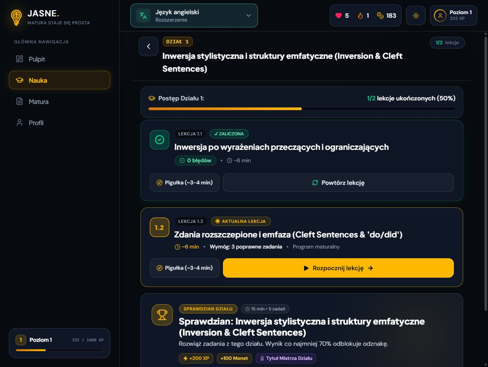
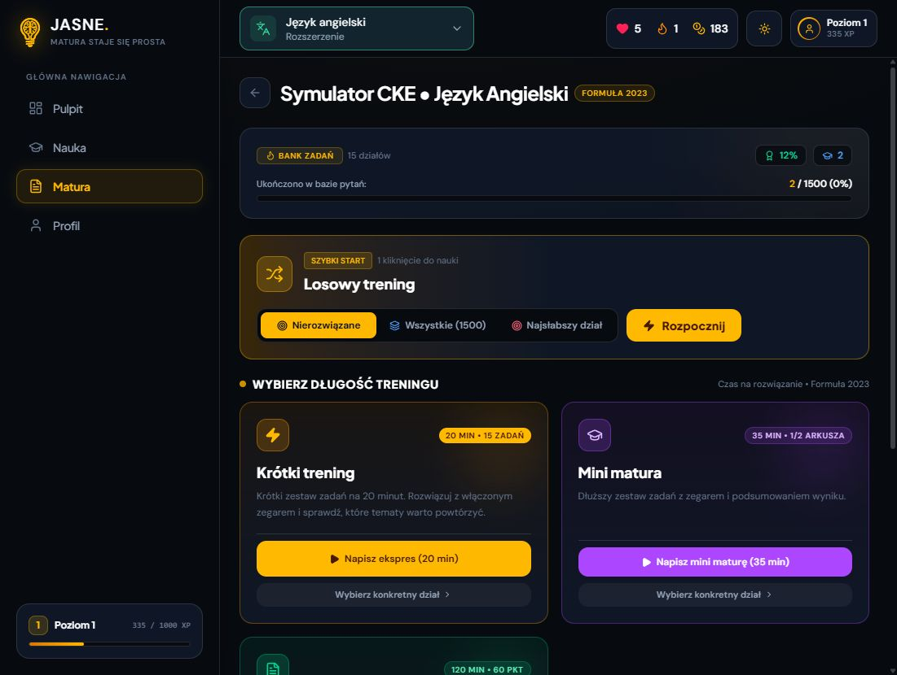
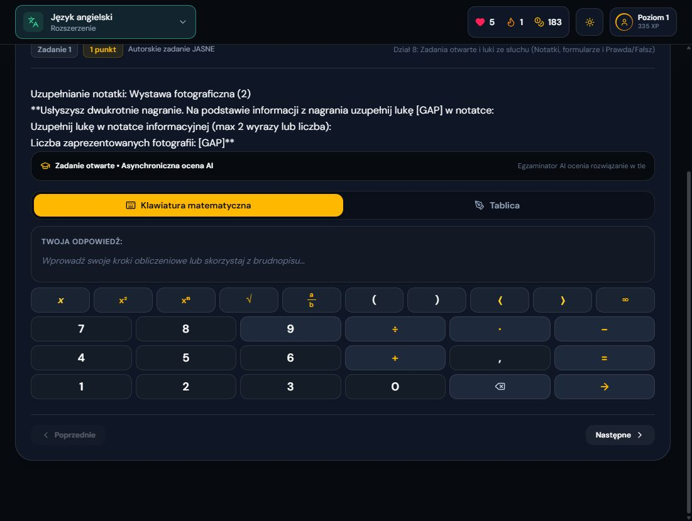
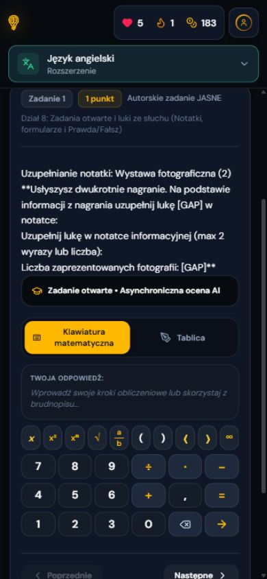
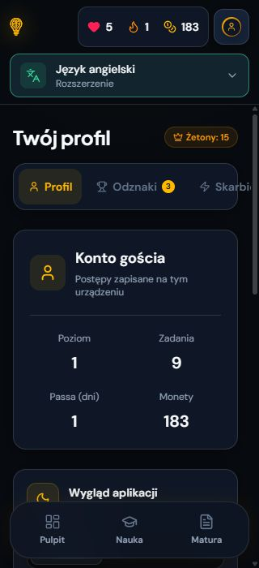
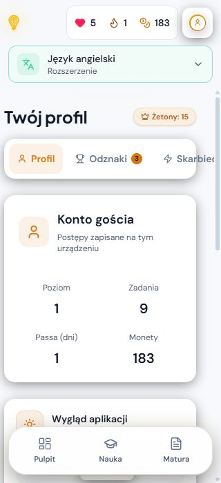

# Krytyczny audyt JASNE — 13 listopada 2026

## Werdykt

Aplikacja ma działający szkielet nauki i coraz spójniejszy interfejs, ale nie jest gotowa do prezentowania jako kompletne, wiarygodne przygotowanie maturalne. Najpoważniejsze problemy dotyczą treści, wyboru poziomu, symulatora i prognozy. Kolejne wygładzenie kart nie usunie tych błędów.

Audyt obejmuje lokalną aplikację na branchu `codex/ui-audit-fixes`, przeglądarkę wbudowaną, komputer oraz widoki 390 × 844 i 320 × 700, kod, wszystkie lokalne banki treningowe oraz publiczne dokumenty treści Firestore. Nie odczytywano prywatnych dokumentów użytkowników. W tej turze nie zmieniano kodu produktu, nie publikowano treści i nie wykonywano płatności.

## Czy zadania są autentyczne i czy jest ich wystarczająco dużo?

| Kurs | Lekcje | Rekordy treningowe | Różne zestawy treści i odpowiedzi | Potwierdzone pochodzenie CKE |
|---|---:|---:|---:|---|
| Matematyka podstawowa | 75 | 1500 | 1500 | Osobny bank: 211 podzadań z 6 arkuszy 2023–2024 |
| Matematyka rozszerzona | 75 | 1500 | 1500 | Brak opublikowanego banku oficjalnych arkuszy |
| Angielski podstawowy | 49 | 1500 | **90** | Ogólne odwołania do CKE nie pozwalają ustalić arkusza i zadania |
| Polski | 34 | 910 | **435** | Osobny bank 31 zadań także nie ma pełnego potwierdzenia pochodzenia |
| Angielski rozszerzony | 18 w Firestore | 72 zadania w lekcjach | 72 | Brak pełnej identyfikacji źródeł; wszystkie zadania jednokrotnego wyboru |

„Różne” oznacza porównanie znormalizowanej treści, odpowiedzi i kontekstu: tekstów, stwierdzeń, części zadania, diagramów i innych materiałów. Nie liczono ponownie zadania tylko dlatego, że ma inny identyfikator. To kontrola duplikatów, nie pełna redakcja merytoryczna ani automatyczne rozpoznawanie wszystkich podobnych parafraz. Zgodne treści nie muszą też oznaczać błędu, jeśli powtórzenie jest celowo zaplanowane; tutaj skala i przypisania są problemem.

### Angielski: licznik bardzo zawyża rzeczywistą różnorodność

W podstawie 1410 z 1500 rekordów powtarza wcześniejszy zestaw treści i odpowiedzi. Pierwsza lekcja zapowiada Present Simple i Present Continuous, lecz jej pięć identyfikatorów prowadzi do pięciu kopii pytania o pierwszy okres warunkowy. Potwierdzono to również w publicznym dokumencie lekcji Firestore. Sześć lekcji ma tylko jedno różne pytanie, mimo że niektóre wymagają kilku poprawnych odpowiedzi. Uczeń może więc zaliczać powtarzany przykład zamiast sprawdzać rozumienie nowego zagadnienia.

Bank treningowy i egzaminacyjny podstawy to ten sam zbiór. W danych nie ma adresów nagrań, choć występują polecenia słuchania. Rozszerzenie ma osobny, starszy kurs w Firestore: 10 tematów, 18 lekcji i 72 pytania wyboru. Nie jest puste, ale taki zakres nie reprezentuje całego egzaminu. Nie ma też jego odpowiednika w centralnym katalogu awaryjnym i aktualnej wspólnej publikacji treści.

Nie ma jednej wymaganej liczby zadań na kurs. Potrzebna jest macierz: temat × umiejętność × format × trudność × poziom. Dziewięćdziesiąt powielanych przykładów nie wystarcza na deklarowane 49 lekcji. Sama rozbudowa licznika do kolejnych tysięcy nie pomoże.

### Matematyka: dobra liczebność, ograniczony zakres oficjalnych materiałów

Oba banki autorskie mają po 1500 różnych problemów i po 20 zadań na lekcję. Powtarzające się ogólne polecenia prawda/fałsz mają różne stwierdzenia, dlatego nie potraktowano ich jako identycznych zadań.

Bank podstawowych arkuszy ma 211 transkrybowanych podzadań. Kontrola generatora i kluczy przeszła dla sześciu arkuszy, każdy po 46 punktów. Próbka pierwszych trzech zadań z maja 2024 jest zgodna z oryginalnym dokumentem. Nie oznacza to ręcznego sprawdzenia każdego z 211 zadań, diagramów i rozwiązań. Wyjaśnienia aplikacji są opracowaniem JASNE. Podzadania i główne numery w arkuszu trzeba rozróżniać przy podawaniu liczników. Źródło porównania: [oficjalny arkusz CKE, maj 2024, udostępniony przez OKE Warszawa](https://www.oke.waw.pl/wp-content/uploads/OKE_WARSZAWA/EM/EM_2023/Arkusze/Arkusze_2024/Matematyka/MMAP-P0-100-A-2405-arkusz.pdf).

Brakuje nowszych roczników oraz oficjalnych arkuszy rozszerzonych. Dalsze uzupełnianie powinno korzystać z [oficjalnego katalogu materiałów egzaminacyjnych](https://egzaminy.gov.pl/egzamin-maturalny/materialy-egzaminacyjne).

### Polski: duplikaty i nierówna głębokość lekcji

910 rekordów odpowiada 435 różnym zestawom. Cztery lekcje mają po jednym zadaniu, siedem po dwa. Część materiałów jest jawnie ćwiczeniowym tekstem JASNE. Nie należy przedstawiać całego banku jako oryginalnych zadań CKE. Potrzebna jest redakcja zgodności z lekcją i pokrycia umiejętności, w tym argumentacji i wypowiedzi pisemnej.

## Lista błędów i ryzyk

### P1 — blokują wiarygodną naukę i premierę

1. **Symulator gubi poziom przedmiotu.** Nagłówek pokazuje angielski rozszerzony, a symulator ładuje podstawowy bank 1500 zadań i podstawowe parametry egzaminu. Potwierdzone w przeglądarce. `App.tsx` przekazuje tylko nazwę przedmiotu, a `MaturaSimulatorView.tsx:338` pobiera stały klucz podstawy. Ten sam brak przekazywania poziomu dotyczy matematyki; jej skutki potwierdzono w kodzie, bez osobnego pełnego egzaminu w przeglądarce.
2. **Losowy zestaw jest nazywany oficjalnym arkuszem.** Angielski losuje 45 pytań z banku i nadaje tytuł „Oficjalny Pełny Arkusz CKE”. Przycisk wyboru arkusza uruchamia losowanie zamiast wyboru konkretnego dokumentu. Zestaw autorski musi mieć taką nazwę; oficjalny wymaga stałej kolejności, materiałów i identyfikacji arkusza. Dowód: `MaturaSimulatorView.tsx:841–857`.
3. **Słuchanie bez nagrania i zły edytor odpowiedzi.** W uruchomionym egzaminie angielskiego pojawiło się polecenie słuchania, ale nie było odtwarzacza ani pliku audio. Do luki tekstowej pokazano matematyczną klawiaturę i instrukcje obliczeń. Widoczne były surowe znaczniki `**` i `[GAP]`. Potwierdzone na komputerze i telefonie. Takie zadanie nie daje uczciwej możliwości rozwiązania.
4. **Masowe duplikaty i niezgodność lekcji angielskiego z ćwiczeniami.** Patrz liczby powyżej. Poprawa musi objąć źródła i publikację Firestore, nie tylko etykiety w interfejsie.
5. **Prognoza pomija bieżące identyfikatory zadań.** `extractTopicIdFromEntityId` w `src/lib/maturaPredictor.ts:19` nie rozpoznaje żadnego z 5410 identyfikatorów czterech banków treningowych. Zaliczone lekcje mogą nadal wpływać na wynik, ale składnik oparty na wykonanych zadaniach nie działa zgodnie z założeniem. Dodatkowo oczekiwane liczby lekcji są częściowo stare.
6. **Wyniki egzaminów mieszają się między przedmiotami.** `maturaBestScore` i `maturaAttempts` są wspólne. Trzypytaniowa diagnoza również je aktualizuje (`App.tsx:784`). Prognoza może traktować taki wynik jako doświadczenie egzaminacyjne i wykorzystywać go przy innym przedmiocie. Potrzebne rozdzielenie przedmiotu, poziomu, diagnozy i pełnego arkusza.
7. **Prognoza wygląda bardziej naukowo, niż wynika z implementacji.** To heurystyka z bazą 12%, wagami i szacowaną pewnością, bez przedstawionej walidacji na rzeczywistych wynikach. Należy naprawić dane wejściowe, ograniczyć komunikaty o pewności i jasno nazwać estymację.
8. **Ekonomia opiera przyznawanie wartości na kliencie.** Reguły Firestore ograniczają zakres i przyrost pojedynczego zapisu, ale nie zastępują autorytatywnego serwerowego przyznawania nagród. Powtarzalne zapisy mieszczące się w limitach pozostają ryzykiem. Nie wykonywano próby nadużycia. Przed płatnościami potrzebne są serwerowe, idempotentne operacje.

### P2 — niespójność UI, informacji i utrzymania

9. **Zakładki profilu są ucięte na 320 px.** Kontener kończy się na 284 px, a przycisk „Skarbiec” sięga około 327 px. Ukrycie overflow maskuje problem bez poziomego przewijania dokumentu. Potwierdzone w jasnym i ciemnym motywie. Potrzebne zawijanie, przewijalny pasek z widoczną wskazówką albo układ dopasowany do szerokości.
10. **Nagłówek jest wizualnie ujednolicony, ale nie gwarantuje zgodnego kontekstu.** Selekcja, kolor i poziom są czytelniejsze. Stan przedmiotu i poziomu musi jednak sterować całą ścieżką, nie tylko podpisem. Na telefonie ekran egzaminu ma dodatkowo około 129 px nagłówka i małe kontrolki; część celów dotykowych ma 28–34 px wysokości.
11. **Opis punktacji matematyki jest niezgodny z archiwum.** Interfejs ogólnie deklaruje 50 punktów, a posiadane arkusze 2023–2024 mają po 46. Punkty, czas i liczba głównych zadań powinny pochodzić z metadanych konkretnego arkusza (`MaturaSimulatorView.tsx:1465`).
12. **Słownictwo o źródłach nadal jest sprzeczne.** Wspólny badge poprawnie odróżnia autorskie zadania od CKE na podstawie metadanych, lecz tytuły symulatora i komentarze danych nadal ogłaszają autentyczność bez dowodu. Pełne źródło powinno zawierać rok, sesję, poziom, arkusz, numer i link. Metadane same nie dowodzą poprawności transkrypcji.
13. **Motyw jasny ma ciężkie, szare cienie i słabszą spójność powierzchni.** Automatyczne przemapowanie kolorów nie daje tej samej jakości co ciemny motyw. Starsze ekrany symulatora mają też inne gradienty i hierarchię niż poprawiony profil. To ocena wizualna, nie pomiar niezgodności kontrastu z WCAG.
14. **Duży pakiet początkowy.** Główny JS po buildzie ma około 8,54 MB, 1,27 MB gzip. Część banków importowana jest jednocześnie statycznie i dynamicznie, więc podział nie działa zgodnie z intencją. Wczytywanie kursów również obejmuje przedmioty inne niż aktualnie wybrany. Potrzebne pomiary na wolnym telefonie i rzeczywiste ładowanie na żądanie; nie wykonano pełnego benchmarku wydajności.
15. **Pełny zestaw testów nie jest zielony.** Dwa testy integracji polskiego oczekują starego tytułu lobby i starej etykiety zamknięcia. Aktualny komponent ma nowy nagłówek i przycisk z `aria-label`. Trzeba dostosować testy do nowego kontraktu i sprawdzić wybór przedmiotu, a nie ignorować niepowodzenia.
16. **Niekompletne funkcje handlowe.** BLIK i złoty awatar są obecnie jawnie niedostępne, co jest uczciwsze niż pozorowanie zakupu. Nadal nie stanowią gotowej funkcji. Pozostają wcześniejszymi zadaniami wdrożeniowymi.

## Jak aplikacja działa

Nagłówek ustala przedmiot i poziom. Pulpit pokazuje cel, aktywność i heurystyczną prognozę. Nauka pobiera tematy i lekcje, a sesja prowadzi przez teorię, ćwiczenia, odpowiedzi i wynik; błędy mogą trafić do powtórek. Profil agreguje postęp, odznaki i waluty. Symulator jest osobną ścieżką z własnymi pulami i sposobem generowania zestawów — właśnie tam kontekst poziomu i nazwy źródeł się rozchodzą.

Treść kursów przechodzi przez `curriculumRepository.ts`: świeża pamięć lub zapis lokalny, następnie Firestore, przy problemach starsza kopia danych chmurowych, a na końcu centralny katalog `src/data/offline`. Świeżość cache wynosi 12 godzin, próba chmurowa ma limit około 5 sekund, a awaryjne pobrania są ponawiane z ograniczeniem. To mechanizm cache-first; każdy ekran nie pobiera całego materiału od nowa.

Banki Firestore są dzielone na fragmenty z manifestem. Sprawdzane są liczba rekordów i unikalność identyfikatorów, ale nie powtarzalność treści, zgodność z lekcją ani autentyczność źródła. Rewizje opublikowanych manifestów odpowiadają lokalnym bankom: wykryte problemy dotyczą także opublikowanych treści. Angielski rozszerzony jest starszym osobnym kursem, bez spójnej ścieżki awaryjnej.

Postęp gościa jest lokalny. Po zalogowaniu stan użytkownika synchronizuje się z Firestore. Komunikacja z modelami AI przechodzi przez backend, co zachowuje oddzielenie kluczy od przeglądarki. Audyt nie obejmował poprawności wszystkich odpowiedzi AI.

## Co jest dobre

- Wspólny selektor i model przedmiotów, poprawiona typografia profilu, spójniejsze przyciski i nagrody.
- Centralne repozytorium treści, cache i uporządkowana lokalna kopia awaryjna.
- Duże, rzeczywiście zróżnicowane banki matematyczne oraz identyfikowalne archiwum podstawy.
- Rozróżnienie źródeł w badge’ach i jawne blokady niedokończonych zakupów.
- TypeScript i produkcyjny build przechodzą.

## Kolejność dalszych prac

1. Naprawić przekazywanie poziomu, nazwy zestawów i dobór edytora; zablokować zadania słuchania bez nagrania.
2. Przebudować angielski: usunąć przypadkowe duplikaty, przypisać pytania do właściwych lekcji, dodać formaty egzaminacyjne i prawdziwe materiały źródłowe. Następnie opublikować poprawiony bank.
3. Naprawić mapowanie prognozy i rozdzielić wyniki według przedmiotu, poziomu i rodzaju sprawdzianu.
4. Zweryfikować każdy deklarowany arkusz z oryginałem; uzupełnić aktualne roczniki i rozszerzenie. Dla autorskich treści przeprowadzić redakcję odpowiedzi, pułapek i trudności.
5. Dopiąć 320 px, małe przyciski, jasny motyw i odchudzić pobierane pakiety. Uaktualnić testy integracji.
6. Przed uruchomieniem płatnej ekonomii przenieść przyznawanie nagród i potwierdzanie transakcji na serwer.

Warunek uznania poprawy: test scenariusza dla każdego przedmiotu i poziomu — wybór → właściwa lekcja → różne pasujące zadania → wynik → powtórka → prognoza; osobno konkretny oficjalny arkusz z właściwą punktacją. Kontrola na komputerze, 320 px i 390 px, z awarią Firestore i bez niej.

## Dowody i walidacja

- Inwentaryzacja: `artifacts/critical-audit/content-inventory.json`.
- Publiczna migawka treści: `artifacts/critical-audit/public-firestore-snapshot.json`.
- Niedopasowane identyfikatory prognozy: `artifacts/critical-audit/predictor-id-mapping.json`.
- Testy: 528 zaliczonych / 530; dwa niepowodzenia w `PolishModuleIntegration.test.tsx`. Dodatkowo środowisko zgłosiło problem zamykania procesu testowego. Nie jest to błąd konsoli przeglądarki.
- TypeScript: zaliczony. Build: zaliczony, z ostrzeżeniami o wielkości i mieszanych importach.
- `node scripts/math_pp/build_cke.js --check`: zaliczony dla 6 arkuszy i 211 podzadań.

### Zrzuty z obecnego audytu

## Ograniczenia

Nie rozwiązano ręcznie wszystkich zadań, nie zweryfikowano każdej transkrypcji względem oryginału, nie wykonano pełnego testu WCAG, fizycznej klawiatury telefonu, testu obciążeniowego ani penetracyjnego. Kontrola responsywna używała zmiany rozmiaru przeglądarki. Wcześniejsze raporty dokumentują pełniejsze przewijanie map, profilu, odznak i skarbca; obecny audyt pogłębia kontrolę treści i logiki. Brak problemu na sprawdzonym ekranie nie oznacza zgodności wszystkich stanów.

## Zgodność z Bazą Wiedzy JASNE

Ocena uwzględnia Nocturne Luminary, wspólny stan przedmiotu, Firestore jako źródło treści z centralną kopią awaryjną oraz Core-4. Powtarzanie jednego niedopasowanego pytania i brak zróżnicowanych formatów nie realizują celu dydaktycznego. Audyt nie zmieniał cen, regeneracji serc, passy, nagród ani zasad bezpieczeństwa. Raport oddziela rozpoznanie metadanych CKE od redakcyjnego potwierdzenia autentyczności.
