# Prognoza, nagłówek i profil — 13 listopada 2026

Zmiany lokalne na branchu `codex/ui-audit-fixes`. Nie wdrożono frontendu publicznie.

## Zmieniony interfejs

- Prognoza używa wspólnego komponentu `PredictionScore` na pulpicie i w szczegółach. Jeden procent z mniejszym znakiem %, punkty jako informacja pomocnicza. Usunięto świecący pierścień, podwójny duży licznik i rozbudowane dekoracyjne statusy.
- Kalibracja nie pokazuje liczbowej prognozy przed zebraniem danych. Punkty mają polski separator dziesiętny. Usunięto sformułowanie sugerujące gwarancję zdania egzaminu.
- Prognozę otwiera prawdziwy przycisk dostępny z klawiatury. Okno ma nazwę, ograniczenie fokusu, zamykanie Escape i powrót fokusu do przycisku wywołującego. Dolny przycisk „Zamknij prognozę” opisuje rzeczywiste działanie.
- Wspólny `SubjectPicker` wyróżnia wybrany przedmiot kolorem i ikoną: matematyka bursztynowa, polski różowy, angielski zielony. Wybrana opcja ma tło i znacznik. Ten sam komponent zastępuje wcześniejszą przewijaną listę przedmiotów w szczegółach prognozy.
- Serca, passa i monety mają jeden układ na komputerze i telefonie: pola dotykowe minimum 44 px, równe ikony i jednolitą typografię liczb. Usunięto miniaturową mobilną pigułkę i pulsowanie ognia.
- Naprawiono panel serc na telefonie: wcześniej znajdował się wewnątrz ukrytego kontenera desktopowego. Teraz jest widoczny, reaguje na Escape i kliknięcie poza panelem. Nie zmieniano kosztów ani regeneracji.
- Profil ma spokojniejsze zakładki, czytelny opis passy i podpisaną historię nauki zamiast powtarzanego dużego licznika zadań oraz legendy koloru.
- „Cel nauki” edytuje preferencje bezpośrednio w profilu. Poprzednio uruchamiał pięcioetapowy onboarding, który dodatkowo przełączał przedmiot na matematykę. Formularz zachowuje szkic do zapisu i obsługuje anulowanie. Aktualizuje tylko `onboardingPreferences`.
- Przełączanie zakładek profilu wraca na początek treści. Przyciski rozwijania rang odznak mają nazwy i większe pola dotykowe. Uporządkowano przycisk doładowania w skarbcu.
- Formularz konta ma powiązane etykiety imienia, e-maila i hasła, odpowiednie autouzupełnianie, większe zamknięcie i prostszy nagłówek.

## Przejście w przeglądarce

Komputer i viewport telefonu 390 × 844: pulpit → prognoza → zmiana przedmiotu → zamknięcie; nagłówek → profil → cel → zapis obecnych wartości; profil → odznaki → rozwinięcie rang → koniec listy → skarbiec → koniec sklepu; profil → formularz logowania → rejestracja → zamknięcie. Sprawdzono kolory matematyki, angielskiego i polskiego, zgodność punktów 50/60 oraz powrót fokusu po Escape.

Nie wykonywano zakupów, odbioru nagród ani utworzenia konta. Zapisano dotychczasowy cel 70% i 10 minut, bez zmiany wartości. Nie testowano fizycznej klawiatury telefonu, faktycznej płatności, wysyłania formularza ani całego jasnego motywu. Nie jest to weryfikacja matematycznej trafności modelu prognozy.

## Weryfikacja kodu

TypeScript bez błędów. 16 testów w czterech zestawach zaliczonych: wyświetlanie prognozy i stan kalibracji, zapis/anulowanie celu, wybór przedmiotu oraz obliczenia prognozy. Końcowy build zakończony powodzeniem. Pozostają znane ostrzeżenia o dużych pakietach i mieszanych importach.

## Zgodność z Bazą Wiedzy JASNE

Zachowano ciemny system Nocturne Luminary i ikony Lucide bez emoji. Kolor przedmiotu oznacza kontekst, a nie zmianę semantyki głównej akcji. Zachowano repozytorium Firestore, stan postępów, ekonomię serc i nagrody. Zmiany preferencji korzystają z istniejącej ścieżki aktualizacji stanu aplikacji.

## Galeria — 20 zrzutów

Zrzuty pokazują kolejne etapy przeglądu. Sufiks `before` oznacza stan sprzed zmian. Panel skarbca pokazano przed ostatnim powiększeniem przycisku doładowania; nie jest to osobny wzorzec projektowy.

### header-hearts-mobile-after.jpg

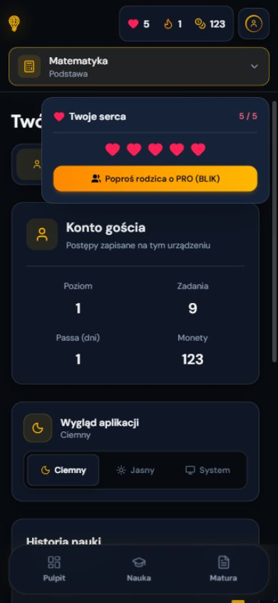

### prediction-dashboard-desktop-after.jpg

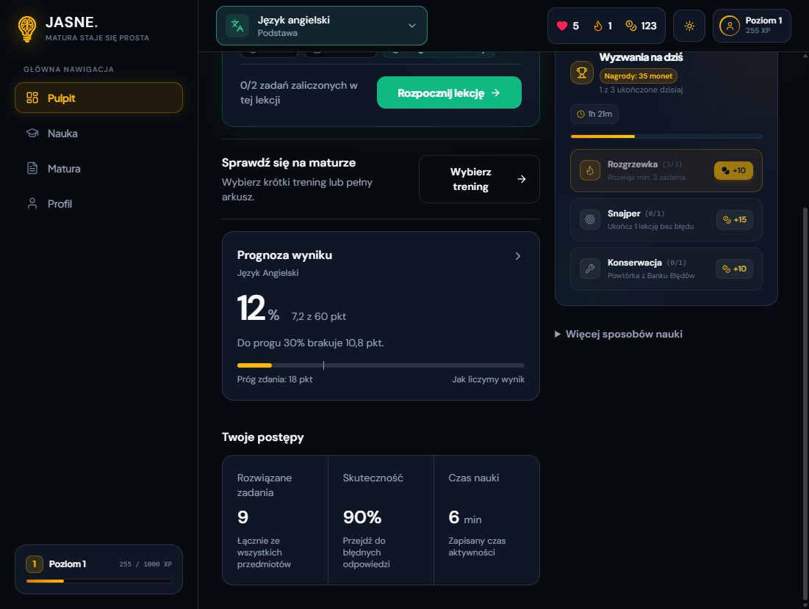

### prediction-dashboard-desktop-before.jpg

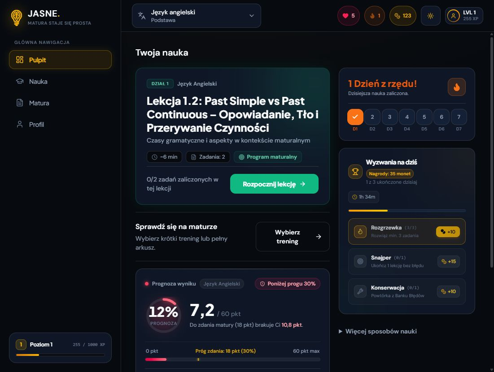

### prediction-dashboard-mobile-after.jpg

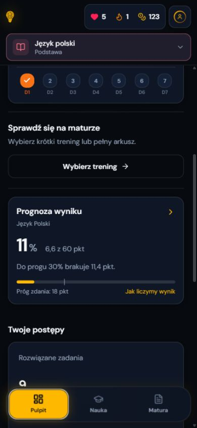

### prediction-details-desktop-after.jpg

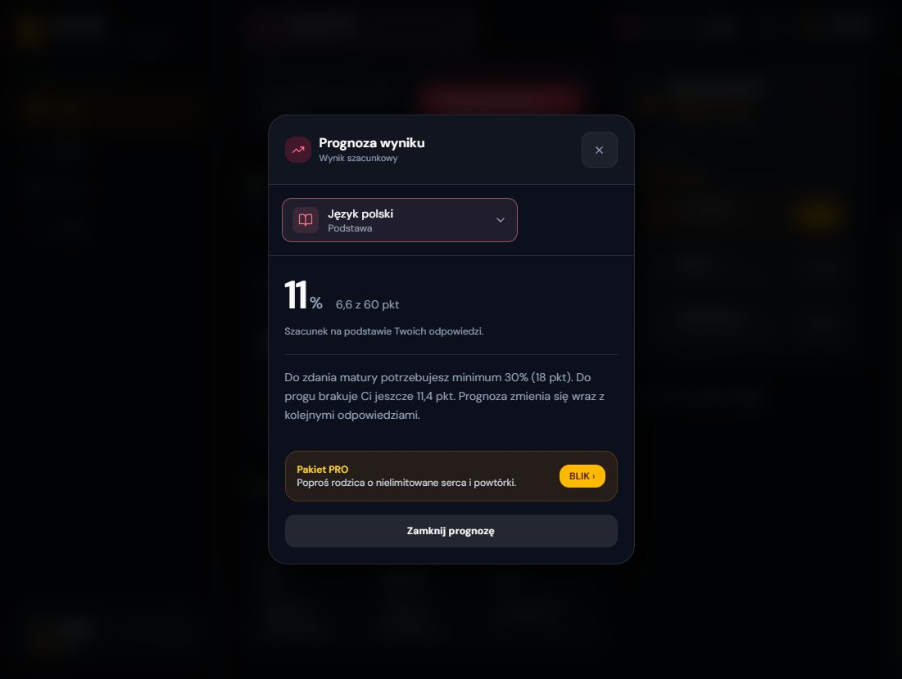

### prediction-details-desktop-before.jpg

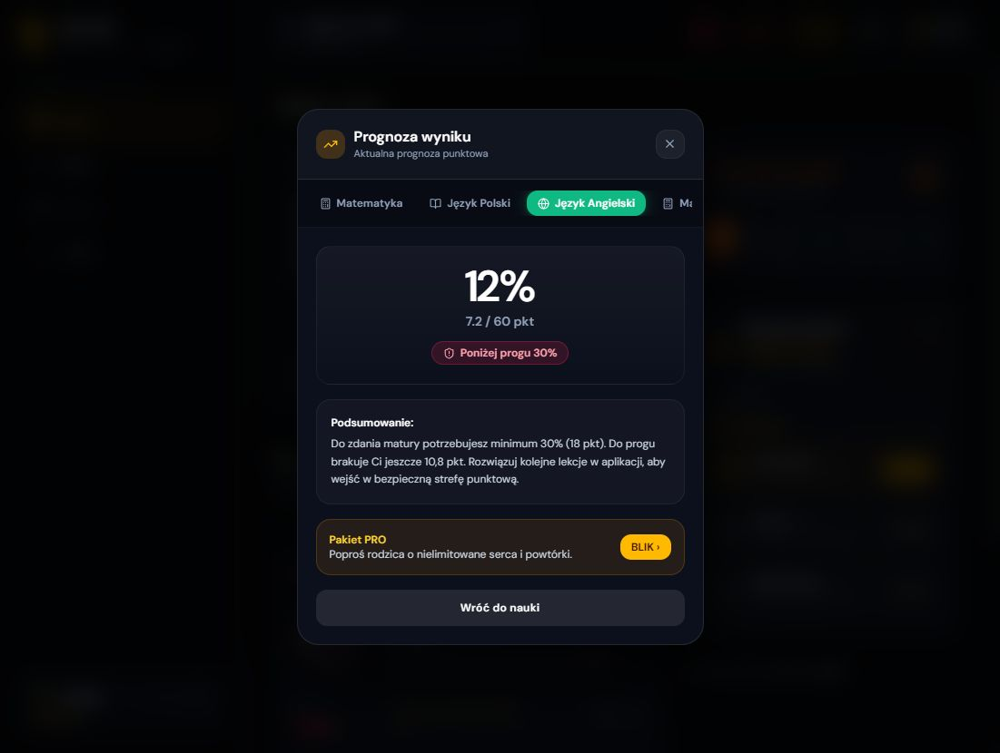

### prediction-details-mobile-after.jpg

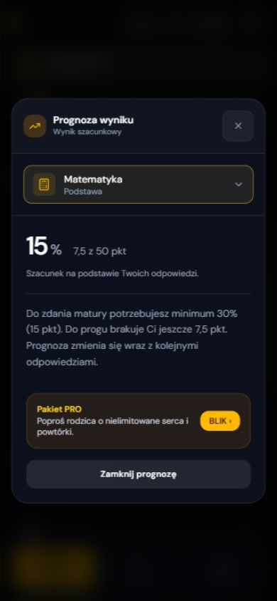

### prediction-english-mobile-after.jpg

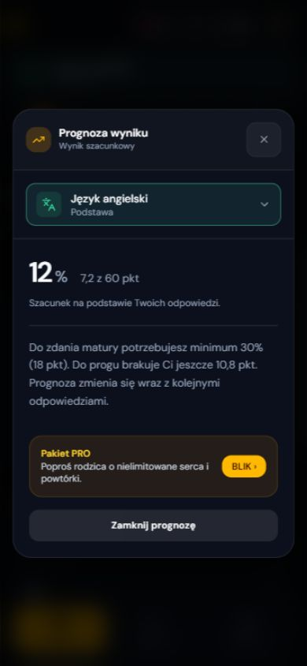

### profile-account-mobile-after.jpg

### profile-badges-mobile-bottom-after.jpg

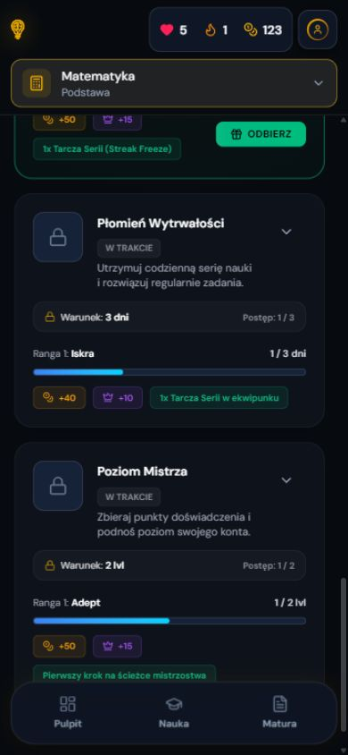

### profile-flow-desktop-before.jpg

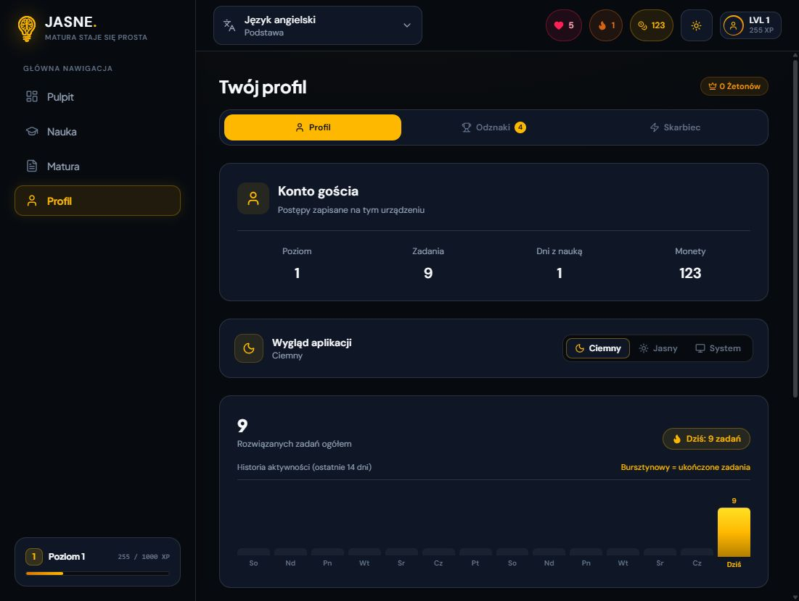

### profile-flow-desktop-bottom-before.jpg

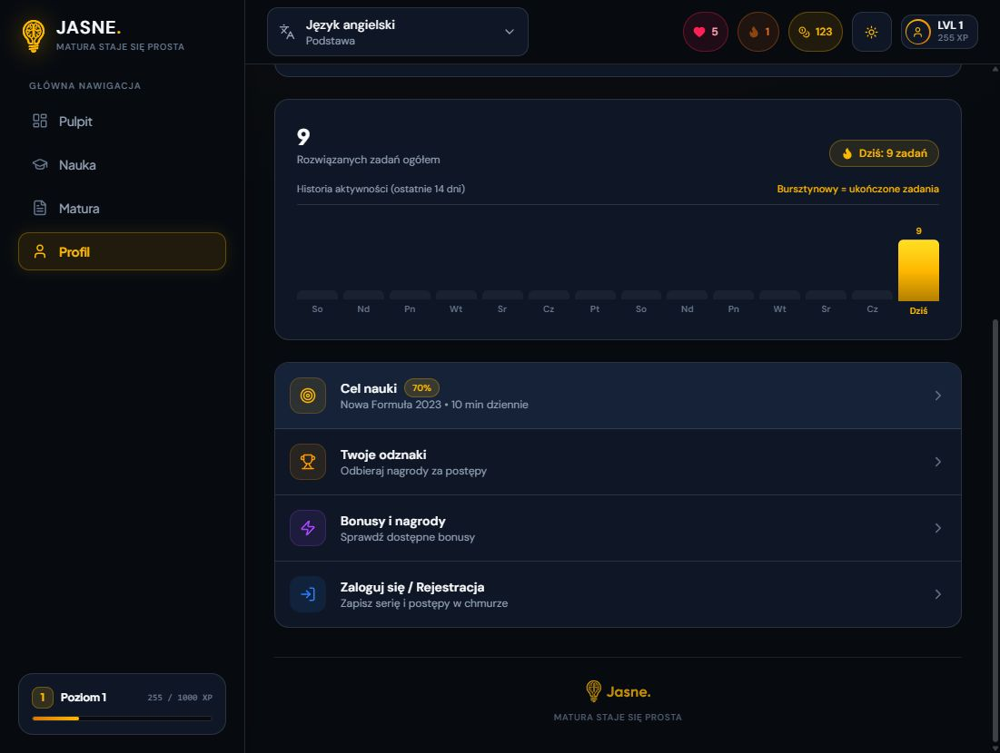

### profile-goal-mobile-after.jpg

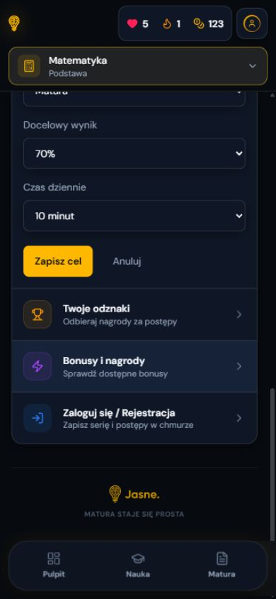

### profile-header-mobile-before.jpg

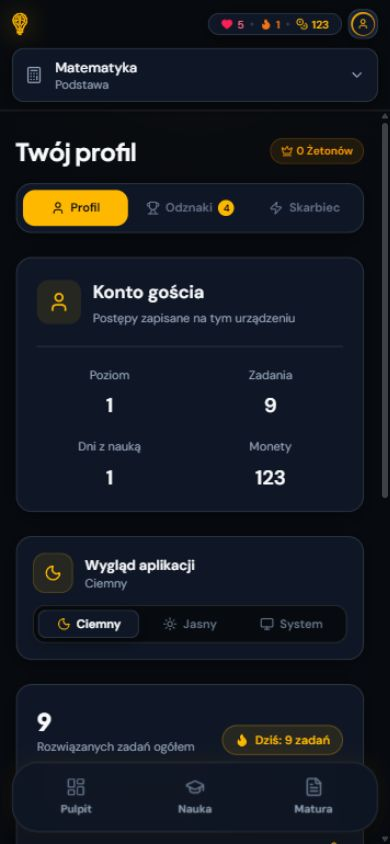

### profile-overview-desktop-after.jpg

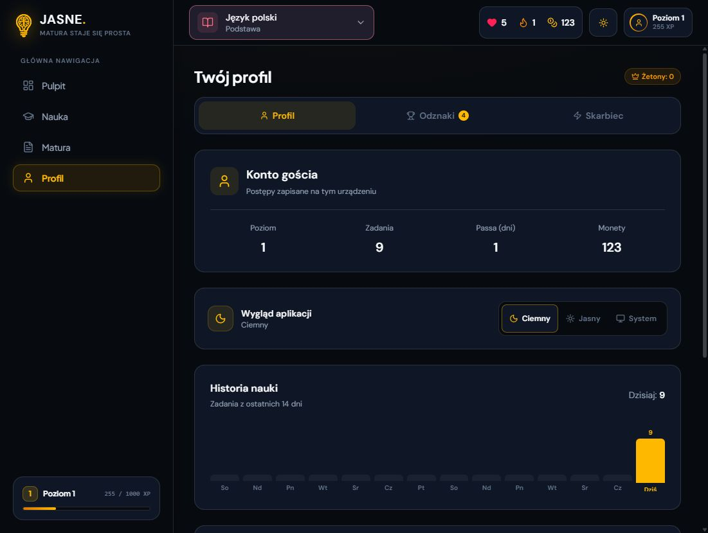

### profile-overview-desktop-bottom-after.jpg

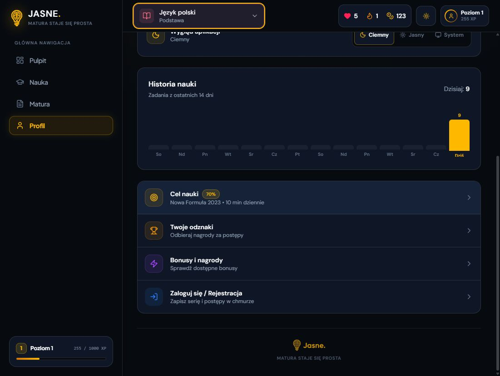

### profile-overview-mobile-after.jpg

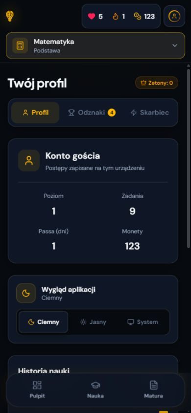

### profile-vault-mobile-bottom-after.jpg

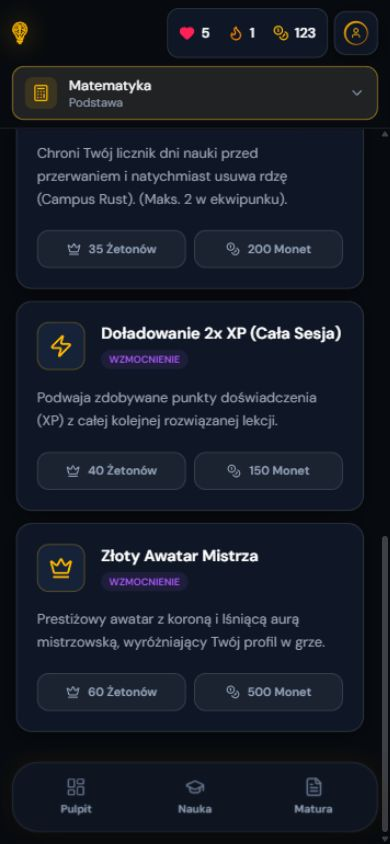

### profile-vault-mobile-top-after.jpg

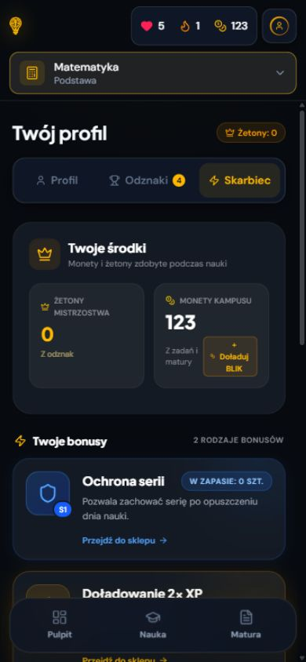

### subject-picker-desktop-after.jpg

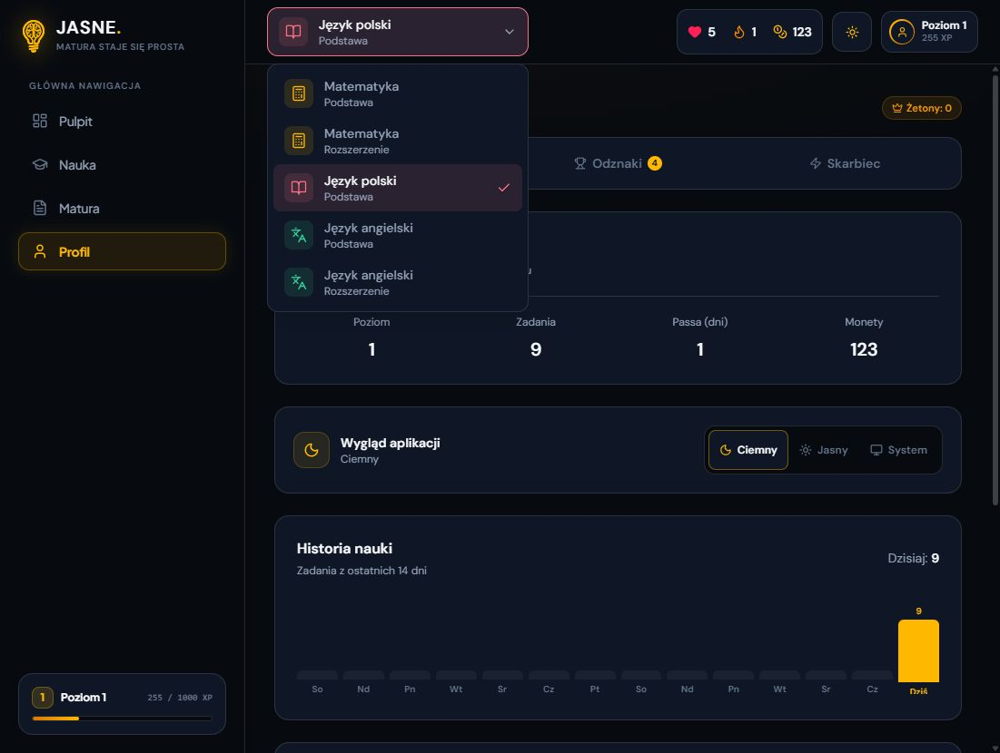
