# Odznaki i skarbiec — 13 listopada 2026

Zmiany są lokalne na branchu `codex/ui-audit-fixes`; frontend nie został wdrożony publicznie.

## Wygląd i język

Wspólne komponenty `RewardButton`, `RewardStatus` i `RewardSummary` oraz style `src/styles/rewards.css` zastępują osobne zestawy przycisków, kolorowych badge’y i drobnych etykiet. Przyciski mają minimum 44 px wysokości, teksty opisowe 14 px, statusy 12 px, nagłówki 16 px. Usunięto ciągłe pulsowanie, poświaty, oznaczenia slotów S1/S3, marketingowe nazwy i etykiety pisane wielkimi literami. Zachowano Nocturne Luminary i Lucide.

Odznaki pokazują jeden postęp, rangę i wszystkie składniki nagrody: monety, żetony oraz wcześniej pomijane XP. Dodatkowe premie wynikają z `perkEffect`, zamiast nieprecyzyjnych opisów. Odebrana ranga nie ukrywa statusu kolejnej nagrody gotowej do odbioru. Filtr „Do odebrania” jest dostępny również przy zerowej liczbie nagród i ma pusty stan z powrotem do listy. Dodano brakujący filtr poziomu. Rozwinięte rangi nie dublują przycisku odbioru.

Skarbiec rozdziela saldo, posiadane bonusy, stałe premie i sklep. Przy braku środków wyjaśnia, ile brakuje w każdej walucie. Osiągnięty limit zapasu blokuje przyciski i wyjaśnia powód. Skrót do sklepu przewija do sekcji i przenosi fokus; link do odznak pozwala wrócić do źródła premii. Ceny, progi i wartości nagród nie zostały zmienione.

## Naprawione błędy działania

- „Mistrz potęg” zliczał wszystkie zadania, mimo opisu sugerującego konkretny dział. Nazwa i opis odpowiadają teraz istniejącemu warunkowi: „Początek nauki”, 3 i 8 zadań. Inne nazwy również uproszczono bez zmiany identyfikatorów i postępów.
- Wynik zakupu czeka na aktualizację stanu, zamiast opierać się na zmiennej zmienianej wewnątrz odroczonego aktualizatora React. Interfejs blokuje ponowny zakup do zakończenia bieżącej operacji i obsługuje niepowodzenie.
- **Złoty awatar:** dotychczasowy produkt pobierał walutę, ale jego `coinBooster` nie miał zaimplementowanego efektu. Zakup został zablokowany zarówno w UI, jak i handlerze aplikacji; widoczny jest stan „W przygotowaniu”. Nie implementowano nowego efektu ekonomicznego.
- **BLIK:** stary formularz symulował autoryzację bankową przez opóźnienie i lokalne przyznanie monet. Zastąpiono go informacją o niedostępności doładowań, bez pola kodu i bez wywołania zakupu. Rzeczywista integracja z operatorem płatności pozostaje do wykonania.

## Sprawdzenie w przeglądarce

Komputer i viewport 390 × 844: odznaki oraz skarbiec przewinięte do końca; rozwinięto pięć rang odznaki zadań; sprawdzono filtry i przejście skarbiec → sklep → odznaki. Filtry zwróciły odpowiednio: zadania 3, passa 2, matura 2, poziom 1, do odebrania 4, wszystkie 8. Sprawdzono otwarcie i zamknięcie informacji o BLIK.

Nie odbierano nagród ani nie wydawano waluty konta gościa. Saldo pozostało 123 monety i 0 żetonów. Odbiór kolejnej rangi oraz zakup zakończony sukcesem, oczekiwanie i blokadę ponownego kliknięcia sprawdzono z kontrolowanymi callbackami w testach. Nie potwierdza to transakcyjności Firestore, której obecny klientowy sklep nie zapewnia. Nie wykonywano płatności i nie podawano kodów BLIK. Nie testowano fizycznego telefonu ani całego jasnego motywu.

## Weryfikacja kodu

TypeScript bez błędów; 21 testów w trzech zestawach zaliczonych; build zakończony powodzeniem. Pozostają wcześniejsze ostrzeżenia o dużych pakietach i mieszanych importach.

## Zgodność z Bazą Wiedzy JASNE

Zachowano paletę, czytelność na smartfonie, jednolitą rodzinę ikon i język bez sztucznego zadęcia. Nie zmieniono cen, progów, naliczania nagród, odnowienia serc ani mechaniki ochrony passy. Wyłączono jedynie działania sugerujące dostępność niezaimplementowanych funkcji. Treści dydaktyczne pozostają w repozytorium Firestore.

## Galeria — 14 zrzutów

Pliki `before` dokumentują poprzedni stan. Pozostałe pokazują kolejne etapy kontroli; stan końcowy jest widoczny na zrzutach komputerowych oraz mobilnych rang, sklepu i doładowań.

### rewards-badges-desktop-before.jpg

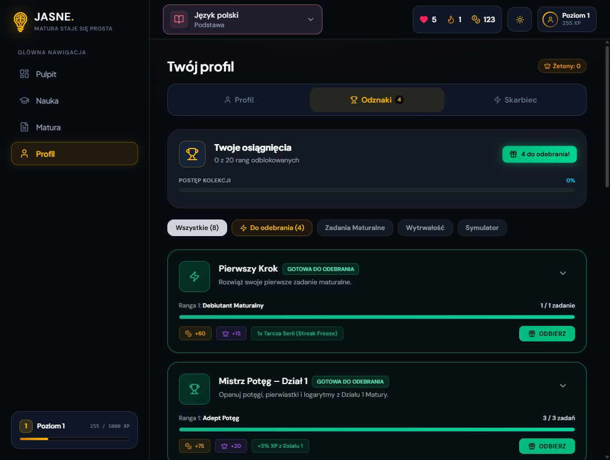

### rewards-badges-desktop-bottom-after.jpg

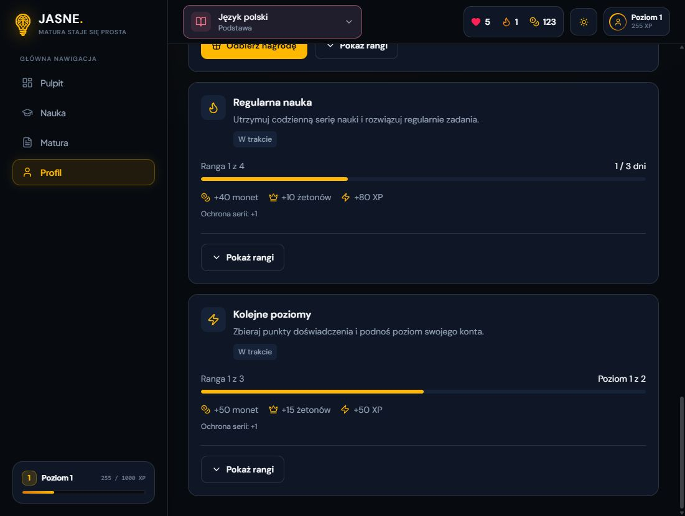

### rewards-badges-desktop-bottom-before.jpg

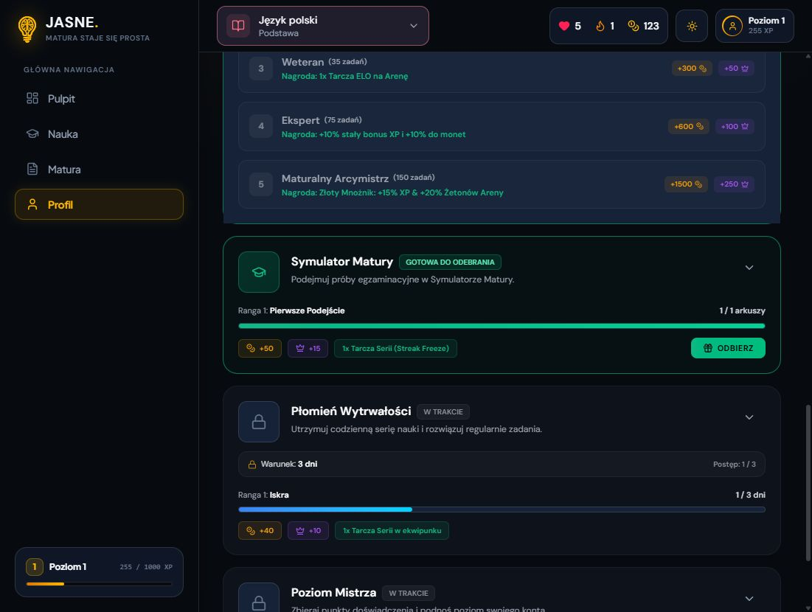

### rewards-badges-desktop-top-after.jpg

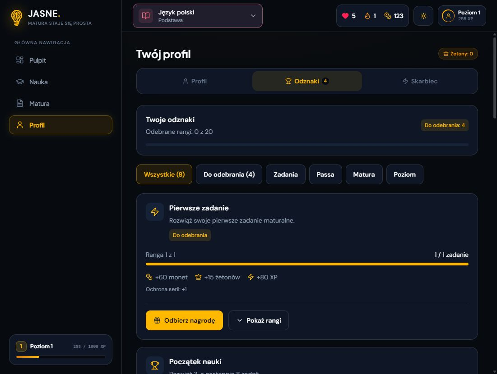

### rewards-badges-mobile-bottom-after.jpg

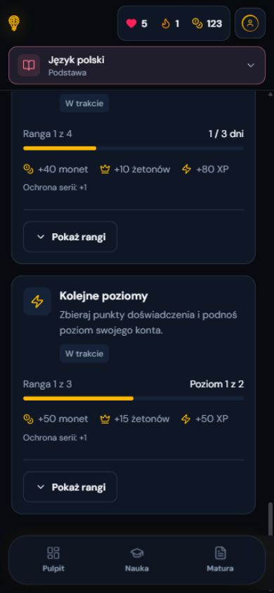

### rewards-badges-mobile-top-after.jpg

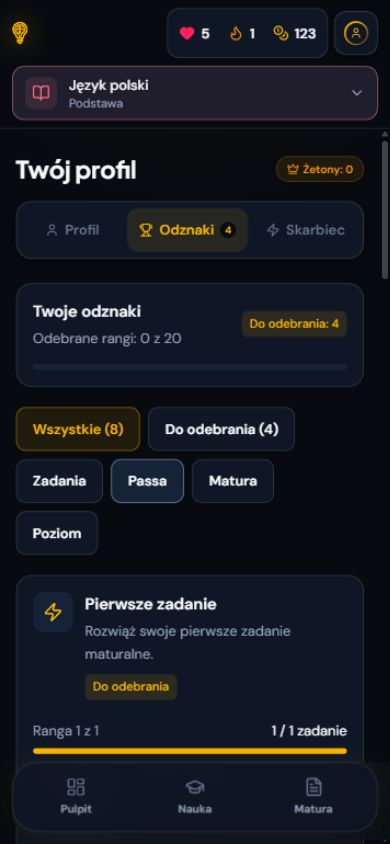

### rewards-ranks-mobile-after.jpg

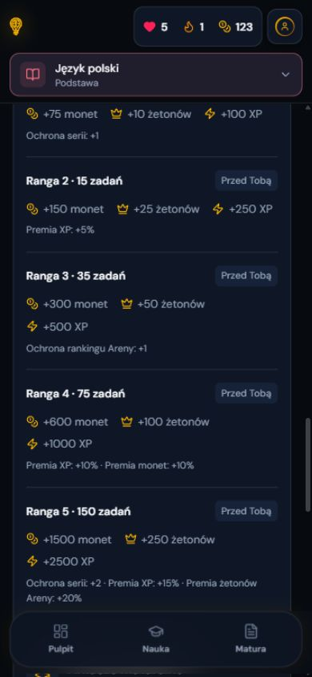

### rewards-shop-mobile-after.jpg

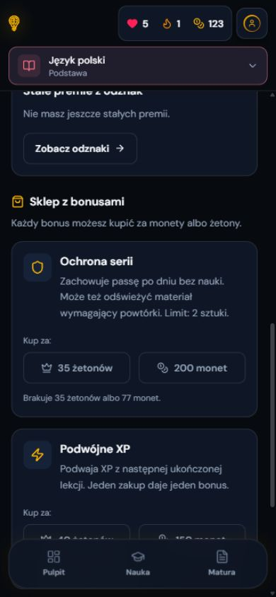

### rewards-topup-mobile-after.jpg

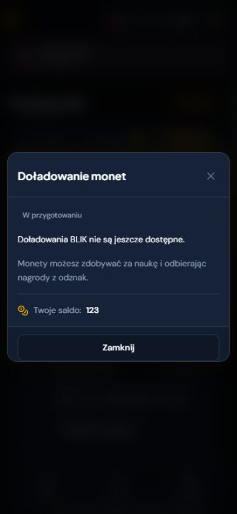

### rewards-vault-desktop-before.jpg

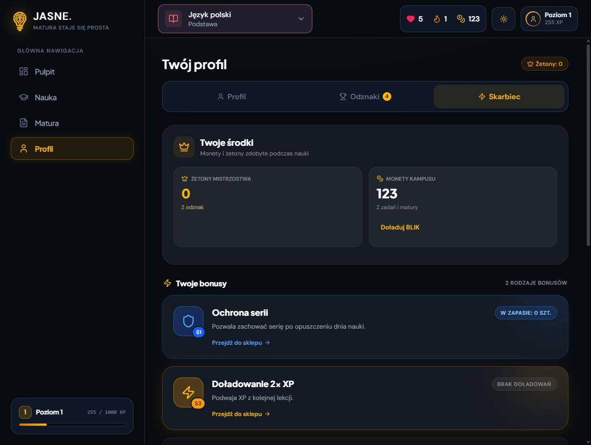

### rewards-vault-desktop-bottom-after.jpg

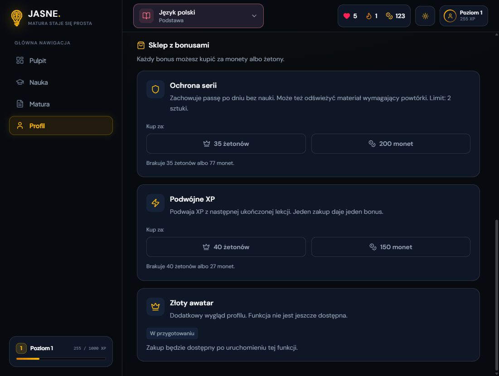

### rewards-vault-desktop-top-after.jpg

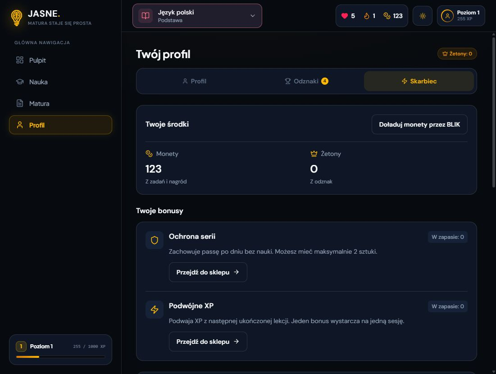

### rewards-vault-mobile-bottom-after.jpg

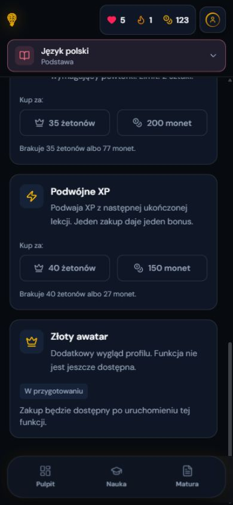

### rewards-vault-mobile-top-after.jpg

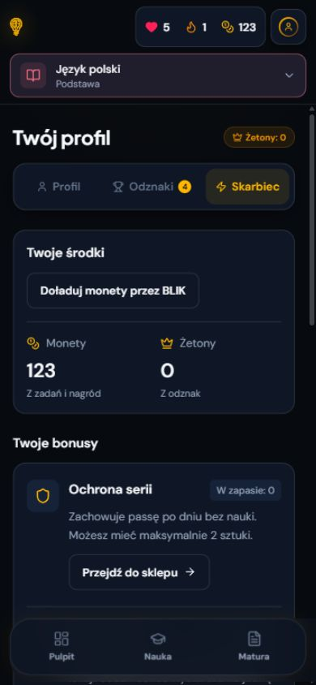
